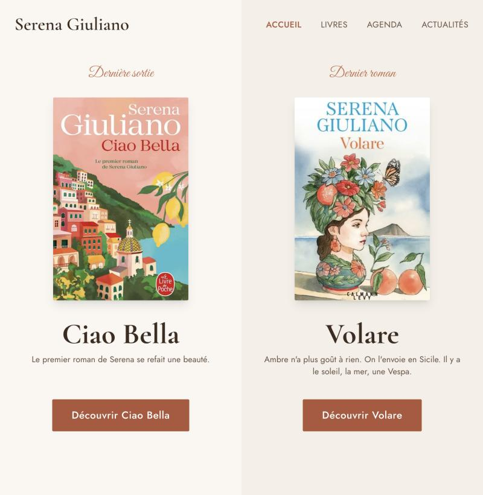
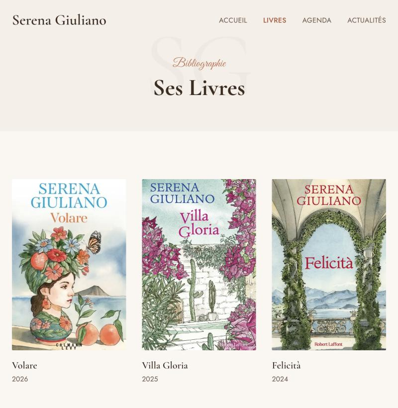
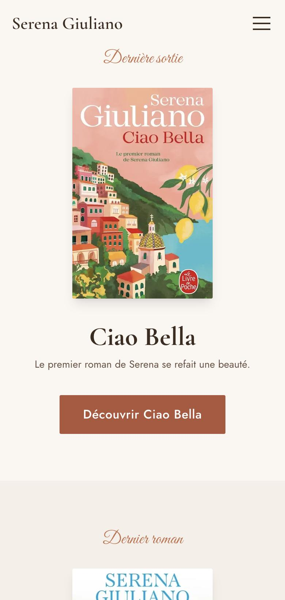

# Serena Giuliano — site officiel

Site vitrine de la romancière **Serena Giuliano**, autrice de huit romans parus
au Cherche-Midi, chez Robert Laffont et chez Calmann-Lévy, et traduite auprès de
plus d'un million de lecteurs.

Conçu et développé de bout en bout : architecture, design, contenu, conformité.

🔗 **[serenagiuliano.fr](https://serenagiuliano.fr)** *(bientôt en ligne)*

---

## Ce que fait le site

Une bibliographie complète et vérifiée, une page d'actualités qui se tient à
jour toute seule, un agenda de dédicaces, et les pages légales qu'impose un site
français.

| Page | Rôle |
|---|---|
| **Accueil** | Dernière parution et dernier roman, côte à côte, puis une biographie courte |
| **Livres** | Les 8 romans, les 3 albums jeunesse et le récit numérique |
| **Fiche livre** | Synopsis, prix, éditions successives, liens d'achat vérifiés |
| **Actualités** | Toutes les parutions, de la plus récente à la plus ancienne |
| **Agenda** | Salons et séances de dédicace |
| **Mentions légales · Confidentialité** | LCEN et RGPD |

---

## Stack

**Next.js 14** (App Router) · **TypeScript** strict · **Tailwind CSS** ·
**Framer Motion** · déploiement statique, sans base de données.

Les 23 pages sont pré-générées au build. Aucune route API, aucune action
serveur : le site est un ensemble de fichiers, servis tels quels.

---

## Les partis pris

### Zéro cookie, zéro traceur

Aucune requête vers un domaine tiers, aucun cookie, aucun stockage local —
vérifié au runtime sur le build de production.

Les polices Google sont téléchargées au build et servies depuis le site. Les
réseaux sociaux sont de simples liens, pas des widgets. Conséquence directe :
**aucun bandeau de consentement n'est nécessaire**, puisqu'il n'y a rien à
faire consentir.

### Accessible, et rapide partout

Contrastes conformes AA, focus clavier visible, `prefers-reduced-motion`
respecté, textes alternatifs en français.

Testé de **320 px** — un iPhone SE de première génération — à **1440 px** :
aucun débordement horizontal. Les images sont servies en WebP aux navigateurs
récents et **en JPEG aux appareils anciens**, automatiquement.

---

## Pourquoi le code n'est pas ici

Le dépôt applicatif est privé. Il contient les 21 couvertures fournies par les
éditeurs et le portrait de l'autrice, dont la rediffusion suppose des
autorisations écrites.

---

## Crédits

Portrait de Serena Giuliano : **Pauline Darley**.
Couvertures : Le Cherche-Midi, Robert Laffont, Calmann-Lévy, Le Livre de Poche,
Pocket. Albums *Nina & Bruno* illustrés par **Mathou**.
