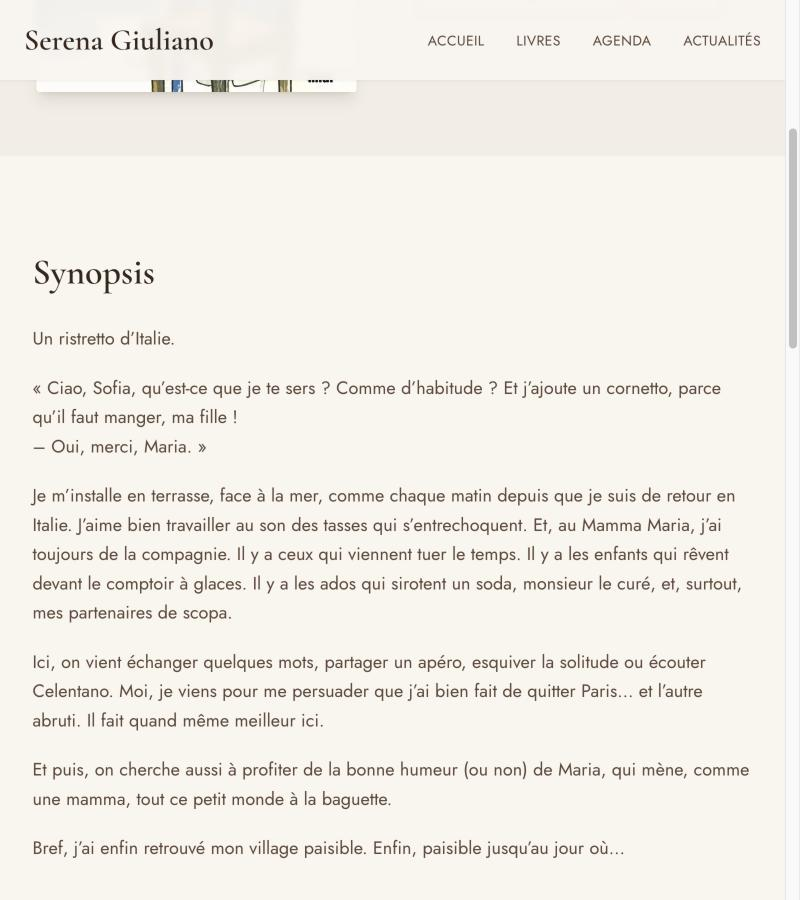

# Serena Giuliano — site officiel

Site vitrine de la romancière **Serena Giuliano**, autrice de huit romans parus
au Cherche-Midi, chez Robert Laffont et chez Calmann-Lévy, lue par plus d'un
million de lecteurs.

Conçu et développé de bout en bout : architecture, design, contenu, conformité,
mise en production.

🔗 **[serenagiuliano.fr](https://serenagiuliano.fr)** — en ligne depuis octobre 2026

---

## Ce que fait le site

Une bibliographie complète et vérifiée, une page d'actualités qui se tient à
jour toute seule, un agenda de dédicaces, et les pages légales qu'impose un
site français.

| Page | Rôle |
|---|---|
| **Accueil** | Dernière parution et dernier roman, côte à côte, puis une biographie courte |
| **Livres** | Les 8 romans, les 3 albums jeunesse et le récit numérique |
| **Fiche livre** | Quatrième de couverture, prix, éditions successives, liens d'achat vérifiés |
| **Actualités** | Toutes les parutions, de la plus récente à la plus ancienne |
| **Agenda** | Salons et séances de dédicace |
| **Mentions légales · Confidentialité** | LCEN et RGPD |

---

## Stack

**Next.js 14** (App Router) · **TypeScript** strict · **Tailwind CSS** ·
**Framer Motion** · hébergé sur **Netlify**, sans base de données.

Les 18 pages sont pré-générées au build. Aucune route API, aucune action
serveur : le site est un ensemble de fichiers, servis tels quels.

---

## Les partis pris

### Aucune donnée inventée

C'est le site officiel d'une autrice réelle : tout ce qui s'y affiche peut être
lu comme une information authentique sur elle et sur ses livres.

Aucun ISBN, aucune date, aucun éditeur n'a été écrit de mémoire. Les 21 ISBN
viennent des fiches éditeurs, et les liens d'achat ont été **ouverts un par un
dans un navigateur** pour vérifier qu'ils renvoient bien le bon titre. Quand
une plateforme ne référence pas un format — Place des Libraires ignore les
ISBN numériques — son bouton n'est pas affiché, plutôt que de mener à
« aucun résultat ».

Les synopsis ne sont pas des résumés : ce sont les **quatrièmes de couverture
des éditeurs, reprises mot pour mot**, jusqu'aux retours à la ligne des
dialogues. La biographie vient de la fiche auteur Babelio.

### Zéro cookie, zéro traceur

Aucune requête vers un domaine tiers, aucun cookie, aucun stockage local —
vérifié au runtime sur le site en production.

Les polices Google sont téléchargées au build et servies depuis le site. Les
réseaux sociaux sont de simples liens, pas des widgets. Conséquence directe :
**aucun bandeau de consentement n'est nécessaire**, puisqu'il n'y a rien à
faire consentir.

### Accessible, et lisible partout

Contrastes conformes AA, focus clavier visible, `prefers-reduced-motion`
respecté, textes alternatifs en français.

Testé de **320 px** — un iPhone SE de première génération — à **1440 px** :
aucun débordement horizontal. La ponctuation double française est précédée
d'espaces insécables, pour qu'un point d'interrogation ne se retrouve jamais
seul en début de ligne sur un écran étroit. Le menu mobile s'ouvre sur un fond
plein plutôt que sur un flou d'arrière-plan, que les navigateurs anciens ne
savent pas appliquer.

---

## Pourquoi le code n'est pas ici

Le dépôt applicatif est privé. Il contient les 21 couvertures fournies par les
éditeurs et le portrait de l'autrice, dont la rediffusion suppose des
autorisations écrites.

---

## Crédits

Portrait de Serena Giuliano : **Pauline Darley**.
Couvertures : Le Cherche-Midi, Robert Laffont, Calmann-Lévy, Le Livre de Poche,
Pocket. Albums *Nina & Bruno* illustrés par **Mathou**.
